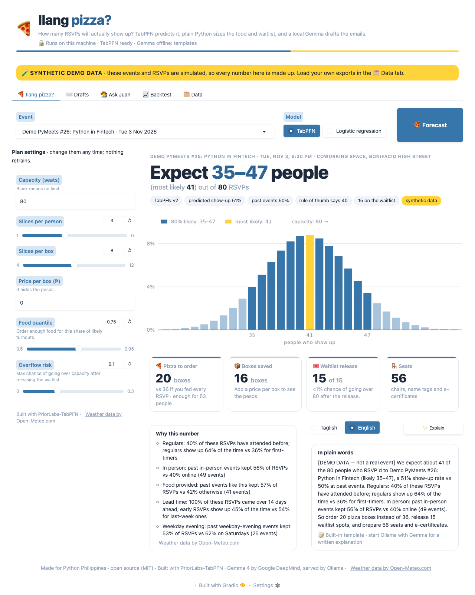
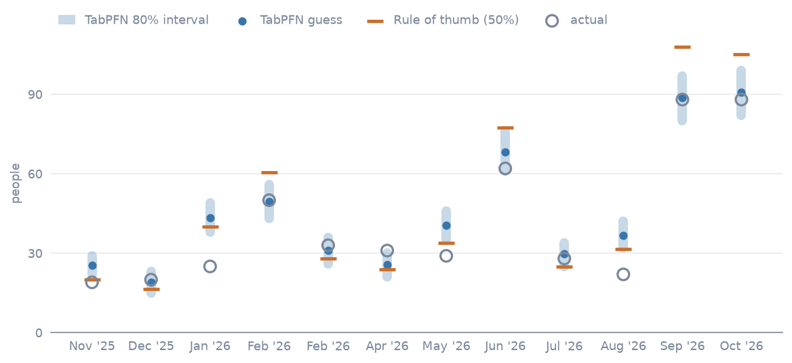
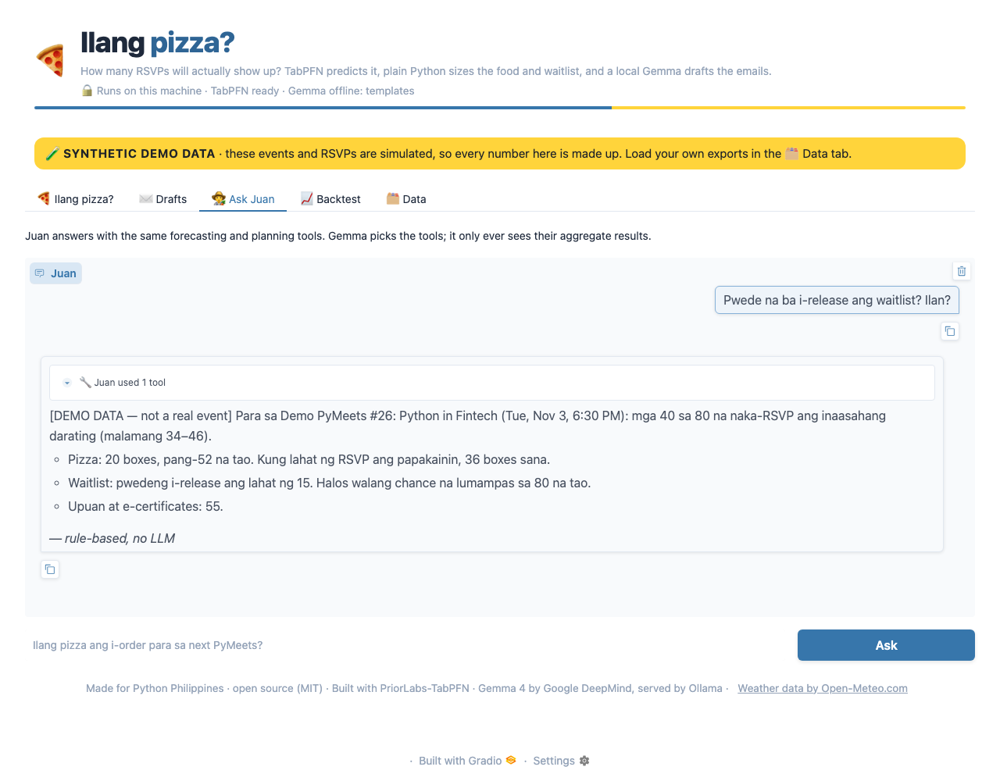

# Ilang pizza?

**Predicts how many of your free-meetup RSVPs will actually show up, then tells you how many pizzas to order.**

*Lazy on purpose: export, run one command, order, nap.*

[](https://github.com/Jericho0912/ilang-pizza/actions/workflows/ci.yml)

[](LICENSE)
[](https://colab.research.google.com/github/Jericho0912/ilang-pizza/blob/main/notebooks/ilang_pizza_colab.ipynb)

**Built with PriorLabs-TabPFN** · Gemma 4 via Ollama · runs on the organizer's laptop

*Ilang pizza?* is Tagalog for "How many pizzas?", the question someone always asks the night
before a meetup. It was built for [Python Philippines](https://python.ph) (PythonPH) and works for
any community that runs free events.

## The problem

As of October 2026, PythonPH's [Meetup group](https://www.meetup.com/pythonph/) has 3,394 members
and lists 77 past events: PyMeets talks on weekday evenings at office venues in BGC and Makati,
PyWorks workshops on Saturdays, WFH Pythonista online, and PyKids. The events are free, which is
great until the night before:

- **RSVPs aren't turnout.** A free "Going" costs nothing to give, so some of them never come.
- **Pizza for no one.** Order for every RSVP and you pay for boxes nobody eats.
- **A waitlist of people who would have come.** Cap the list at the room's size and you turn
  people away, then watch seats sit empty.
- **Building security wants a number.** BGC and Makati office venues need a headcount ahead of time.
- **Rainy-season Thursdays.** From June to November, a 5 PM downpour decides who makes it through
  traffic.

The fallback is a rule of thumb: "half will show." Ilang pizza? replaces it with a forecast you can
check against your own history.

## What it does

- **Predicts who shows up.** [TabPFN](https://github.com/PriorLabs/TabPFN) reads your past RSVP and
  check-in exports and gives each upcoming RSVP a show-up probability.
- **Counts the crowd exactly.** Those probabilities add up to an exact headcount distribution, so
  you get a likely range instead of one hopeful number.
- **Makes the calls.** Pizza boxes, how many waitlist spots to release while keeping the chance of
  overflowing the room under 10%, and how many chairs and e-certificates to prepare.
- **Writes the emails.** Gemma 4, running locally, drafts the reconfirm, waitlist-release, catering
  and venue-headcount emails in Taglish or English.
- **Answers questions.** Ask Juan "Ilang pizza para sa next PyMeets?" and the agent answers by
  calling those same tools.

## Screenshots

All three use the synthetic demo data from `ilang-pizza demo`, so every number in them is made up.

| Forecast and plan | Backtest | Ask Juan |
| --- | --- | --- |
|  |  |  |

## Quickstart

Install with [uv](https://docs.astral.sh/uv/) or pip (Python 3.11+):

```bash
uv tool install git+https://github.com/Jericho0912/ilang-pizza

# or, with pip inside a virtual environment
python -m venv .venv && source .venv/bin/activate    # Windows: .venv\Scripts\activate
pip install git+https://github.com/Jericho0912/ilang-pizza
```

With pip on Linux without an NVIDIA GPU, run
`pip install torch --index-url https://download.pytorch.org/whl/cpu` first to skip the
multi-gigabyte CUDA download.

For the email drafts and Ask Juan, install [Ollama](https://ollama.com) and pull Gemma 4 E4B
(about 7 to 10 GB). Without it, drafts fall back to built-in templates and Juan gives rule-based
answers.

```bash
ollama pull gemma4:e4b
```

Then try everything on the synthetic demo data:

```bash
ilang-pizza demo                                      # made-up PythonPH-style events in data/demo
ilang-pizza doctor                                    # checks TabPFN, Ollama + Gemma and your data
ilang-pizza backtest --data data/demo --last-n 20     # replays past events vs. "half will show"
ilang-pizza plan --data data/demo --capacity 80       # pizza boxes, waitlist spots, seats
ilang-pizza draft --data data/demo --kind reconfirm   # Taglish by default; add --tone english
ilang-pizza ask --data data/demo "Ilang pizza para sa next PyMeets?"
ilang-pizza ui --data data/demo                       # web app at http://127.0.0.1:7860
```

The first TabPFN run downloads the v2 weights (about 30 MB) from Hugging Face. After that it works
offline; add `--no-weather` to skip the rain lookup.

### Or try it on Google Colab

No install, and a GPU instead of your laptop:
[notebooks/ilang_pizza_colab.ipynb](notebooks/ilang_pizza_colab.ipynb) runs the demo, the backtest
and the plan, and optionally Gemma 4 and the web app, inside the Colab runtime. It uses synthetic
data. Upload real data only as the hashed copy described in the notebook, never the raw exports.

## Using your real exports

```text
data/pythonph/
  events.csv                          one row per event
  rsvps/pymeets-2026-09-17.csv        that event's export: Meetup, Luma, ti.to or Google Forms
  attendance/pymeets-2026-09-17.csv   optional check-in list, for exports without one
```

The format of each export is detected automatically. Run `ilang-pizza doctor --data data/pythonph`,
then `ilang-pizza backtest --data data/pythonph` before you trust a plan. Step-by-step exports for
each platform, the `events.csv` columns and privacy tips are in the
**[data guide](docs/data-guide.md)**.

## How it works

```text
RSVP + check-in exports (Meetup · Luma · ti.to · Google Forms)
      │   emails and names hashed on load, raw columns dropped
      ▼
features per RSVP: lead time · attendee history · payday and petsa de peligro
                   holidays and long weekends · wet season · rain on the day
      │
      ▼
TabPFN ──────────► P(show) for each RSVP                      (never leaves the laptop)
      │
      ▼
Poisson-binomial ► exact headcount distribution: expected, p10 / p50 / p90
      │
      ▼
plan.py ─────────► waitlist release · pizza boxes · seats · e-certificates
      │   aggregate numbers only
      ▼
Gemma 4 E4B on Ollama ► reconfirm · waitlist · catering · venue emails
                      └► Ask Juan, an agent that calls the same tools
```

**TabPFN guesses who shows up.** TabPFN is a tabular foundation model, a transformer pretrained on
millions of synthetic datasets, so it learns from your table in a single forward pass. There's no
training loop to babysit and nothing to tune. It suits community data: its
[Nature paper](https://doi.org/10.1038/s41586-024-08328-6) shows it beating tuned baselines on
datasets of up to 10,000 samples, and it handles missing values, such as a first-timer with no
history or a day with no rain data. Ilang pizza? gives it up to 2,000 past RSVPs as context
(longer histories are sampled, keeping the class mix), so a forecast stays quick on a laptop.

**The headcount is exact, not simulated.** Each RSVP is a weighted coin, and guests add heads. The
total of independent, unequal coins follows a Poisson-binomial distribution, computed exactly one
RSVP at a time. Three RSVPs at 90%, 50% and 20% give 0, 1, 2 or 3 heads with probability 4%, 41%,
46% and 9%.

**The decisions are plain arithmetic** on that distribution, with no model and no LLM, so you can
check every number by hand:

- **Waitlist:** release spots in waitlist order while P(heads > capacity) stays at or under 10%
  (`--risk`).
- **Pizza:** feed the 75th-percentile headcount (`--food-quantile`), at 3 slices a head and
  8 slices a box (`--slices`, `--box`). Add `--price` to see what ordering for every RSVP would
  have cost.
- **Seats and e-certificates:** the 90th percentile, enough 9 times out of 10.

**Gemma 4 writes the emails on your machine.** Gemma 4 E4B runs through Ollama and drafts the four
emails in Taglish or English (`--tone`). It only sees aggregates (see
[Privacy design](#privacy-design)), so the venue email says the guest list for building security
will follow separately. If Gemma writes a number that isn't in the plan, you get the built-in
template instead.

**Ask Juan** is named after Juan Tamad, the folk hero who lay under a guava tree waiting for the
fruit to fall into his mouth. Ask in Taglish or English. Gemma picks the tools (`list_events`,
`forecast`, `plan`, `draft`, `backtest_summary`), the tools do the math, and Juan answers from
their results, listing every tool call under the answer.

## How we evaluate it

`ilang-pizza backtest` replays your history honestly:

- **Rolling origin.** Each past event, after the first 6 with check-ins (`--min-train`), is
  predicted by a model fit only on events that started before it, then scored against its real
  check-ins. Then the origin moves forward one event.
- **No leakage.** Features use only what was known before the event started. Attendee history
  counts strictly earlier events, and an event's own attendance is never a feature.
- **Baselines.** The organizers' "half will show" rule (`ILANG_PIZZA_RULE_RATE`), a historical
  average (each series' past show-up rate), and logistic regression on the same features.
- **Metrics.** Mean absolute error in heads (the headline), MAPE, bias (positive means it
  over-predicts), and 80% coverage: how often the real headcount landed inside the p10 to p90
  range. `--csv results.csv` saves the per-event table.

Results on `data/demo` only show that the pipeline runs. The demo data is synthetic, so it says
nothing about real accuracy.

## Why open

- **Attendee data stays on the organizer's laptop.** Names and emails on an RSVP list are personal
  information under the Philippine Data Privacy Act of 2012 (RA 10173). The simplest way to
  protect them is to never upload them: TabPFN runs locally, and Gemma runs on Ollama at
  127.0.0.1.
- **₱0 to run.** No API keys or per-token bills for a volunteer-run group. A laptop is enough.
- **Works offline** on unreliable venue Wi-Fi once the weights are downloaded.
- **Open weights can learn Taglish.** Gemma can be fine-tuned on a community's own announcements;
  a closed API can't. (Not done yet.)
- **Swap models freely:** `--model tabpfn-v2 | tabpfn-3.5 | logistic | history | rule`, and any
  Ollama model through `ILANG_PIZZA_LLM`.
- **Reusable.** It's pip-installable, so GDG, AWS User Group and other PH communities can point it
  at their own exports.

## Privacy design

- **Hashed at the door.** The loaders replace each email (or name, when there's no email) with a
  salted SHA-256 hash and drop the raw columns, custom form answers included, as soon as a file is
  read. The salt lives in `data/<name>/.ilang-pizza-salt`, created on first load.
- **Aggregate-only prompts, enforced.** Gemma gets counts, rates, ranges, the plan, and the event's
  title, date and venue. A guard (`llm.prompts.assert_aggregate_only`) rejects any prompt that
  contains an email address, an attendee hash or a PH phone number before it is sent.
- **Predicts the crowd, not the person.** Per-RSVP probabilities exist only to add up the
  headcount. The CLI and UI show counts, rates and ranges, never a list of who's likely to flake.
  Use it to size the order, not to judge people.
- **`data/` is gitignored** (except `data/README.md`), and so are salt files. Real exports never
  belong in git, issues or screenshots.
- **What touches the network:** the one-time TabPFN weights download from Hugging Face, Open-Meteo
  rain lookups that carry only venue coordinates and dates (`--no-weather` turns them off), and
  `ollama pull`. The web UI listens on 127.0.0.1 with Gradio telemetry off, and `--share` is
  opt-in with a warning.

## Configuration

| Variable | Default | What it does |
| --- | --- | --- |
| `ILANG_PIZZA_DATA` | `data` | Dataset folder used when `--data` isn't given (or the only dataset inside it) |
| `ILANG_PIZZA_CACHE` | `~/.cache/ilang-pizza` | Weather responses and other small caches; safe to delete |
| `ILANG_PIZZA_LLM` | `gemma4:e4b` | Ollama model for the drafts and Ask Juan |
| `OLLAMA_HOST` | `http://127.0.0.1:11434` | Where Ollama is listening |
| `ILANG_PIZZA_TABPFN` | `auto` | TabPFN checkpoint: `auto`, `v2` or `3.5`. `auto` uses TabPFN-3.5 when `TABPFN_TOKEN` is set, otherwise v2 |
| `ILANG_PIZZA_RULE_RATE` | `0.5` | Show-up rate of the "half will show" baseline |
| `TABPFN_TOKEN` | unset | Your Prior Labs API key, once you've accepted the TabPFN-3.5 license (read by `tabpfn`) |

## Upgrading to TabPFN-3.5

TabPFN v2 is the default because its weights are openly licensed (Apache 2.0 plus attribution) and
need no sign-up. TabPFN-3.5 is newer, and its weights are free under a separate non-commercial
license that **you** have to accept. Ilang pizza? never accepts it for you and never opens a
browser to do it.

1. Read the [TabPFN-3.5 license](https://huggingface.co/Prior-Labs/tabpfn_3_5/blob/main/LICENSE).
   In short, it allows non-commercial, non-production use only, restricts the model's outputs the
   same way, and excludes hosted or SaaS use. It also isn't offered to consumers as the German
   Civil Code defines them: by accepting, you confirm you're acting in a professional capacity.
2. Sign in at [ux.priorlabs.ai](https://ux.priorlabs.ai) (it redirects to platform.priorlabs.ai),
   accept the license on the Licenses tab, and copy your API key from your account page.
3. Run `export TABPFN_TOKEN="<your key>"`, then `ilang-pizza doctor`. It should now report
   TabPFN-3.5. If 3.5 can't load, `auto` falls back to v2 and warns you. Pin a checkpoint per
   command with `--model tabpfn-v2` or `--model tabpfn-3.5`.

PythonPH is a volunteer-run, non-commercial community, which is the kind of use non-commercial
terms are written for. The license also rules out production use, though, so read it with your own
situation in mind. This isn't legal advice. When in doubt, stay on v2.

## Limitations

- **It needs past check-ins.** Without a record of who actually came, there's nothing to learn
  from. Start taking attendance now; `doctor` warns below 6 past events with check-ins.
- **No-show behavior drifts.** New venues, new series and the seasons change who comes. Re-run the
  backtest every few events and watch the most recent ones.
- **Small communities have small data.** A few dozen events give wide ranges. Trust the p10 to p90
  range, not the single number.
- **The demo is synthetic.** It's PythonPH-shaped but made up, so results on it are not evidence of
  real accuracy.
- **Walk-ins are invisible.** It forecasts heads among RSVPs and released waitlist spots. People
  who come without an RSVP aren't counted.

## Credits and licenses

- **Built with PriorLabs-TabPFN.** The TabPFN v2 weights are by Prior Labs under the
  [Prior Labs License 1.1](https://huggingface.co/Prior-Labs/TabPFN-v2-clf/blob/main/LICENSE.txt)
  (Apache 2.0 plus an attribution clause), and the [`tabpfn`](https://github.com/PriorLabs/TabPFN)
  package is Apache 2.0. Paper: Hollmann et al.,
  [*Accurate predictions on small data with a tabular foundation model*](https://doi.org/10.1038/s41586-024-08328-6),
  Nature (2025).
- **TabPFN-3.5** (optional) is under the
  [TABPFN-3.5 Non-Commercial License](https://huggingface.co/Prior-Labs/tabpfn_3_5/blob/main/LICENSE),
  which each user accepts for themselves.
- **Gemma 4** is by Google DeepMind under [Apache 2.0](https://ai.google.dev/gemma/docs/gemma_4_license),
  served locally by [Ollama](https://ollama.com) (MIT).
- [Weather data by Open-Meteo.com](https://open-meteo.com/) (CC BY 4.0). PH holidays come from
  [`holidays`](https://github.com/vacanza/holidays) (MIT), and the web UI is
  [Gradio](https://www.gradio.app) (Apache 2.0).
- **Juan Tamad** belongs to Filipino folklore.
- Ilang pizza? itself is [MIT](LICENSE). Full third-party notices, including the text of the Prior
  Labs License, are in [NOTICE](NOTICE).

## Hacktoberfest 2026

Built for DEV's
[Hacktoberfest 2026 Open-Source AI Challenge, Week 3: "Slow and Steady"](https://dev.to/challenges/hacktoberfest-week3-2026-10-19):
build something with open-weight models or open-source AI that rewards laziness. International
Sloth Day was October 20. This one is for the organizer who would rather be under the guava tree.

<!-- TODO: link the DEV post here once it's published. -->

## Contributing

Issues and pull requests are welcome, especially loaders for other export formats and feedback
from other PH communities.

```bash
git clone https://github.com/Jericho0912/ilang-pizza.git && cd ilang-pizza
python -m pip install -e ".[dev]"
ruff check .
pytest
```

Tests that need TabPFN weights, the network or Ollama are skipped unless you set
`ILANG_PIZZA_TEST_TABPFN=1`, `ILANG_PIZZA_TEST_NETWORK=1` or `ILANG_PIZZA_TEST_OLLAMA=1`.
Never put real attendee data in a test, an issue or a screenshot; use `ilang-pizza demo` or the
`tiny_dataset` fixture in `tests/conftest.py`.
